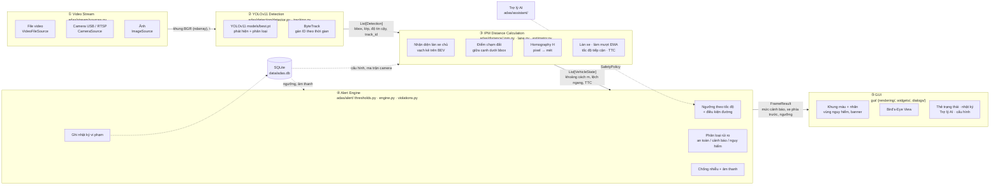
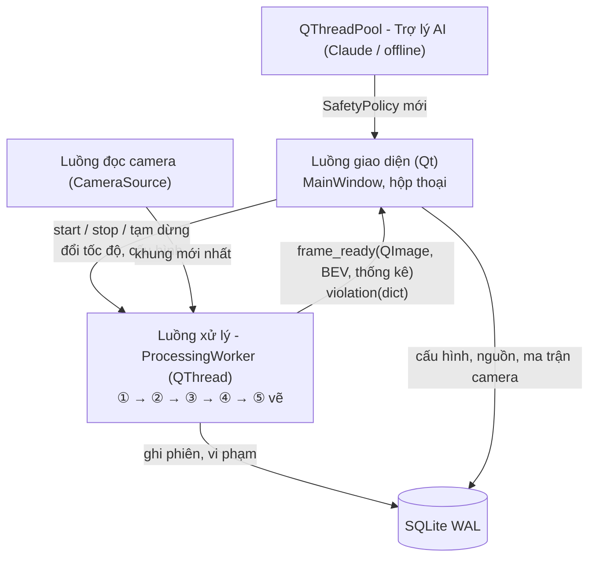
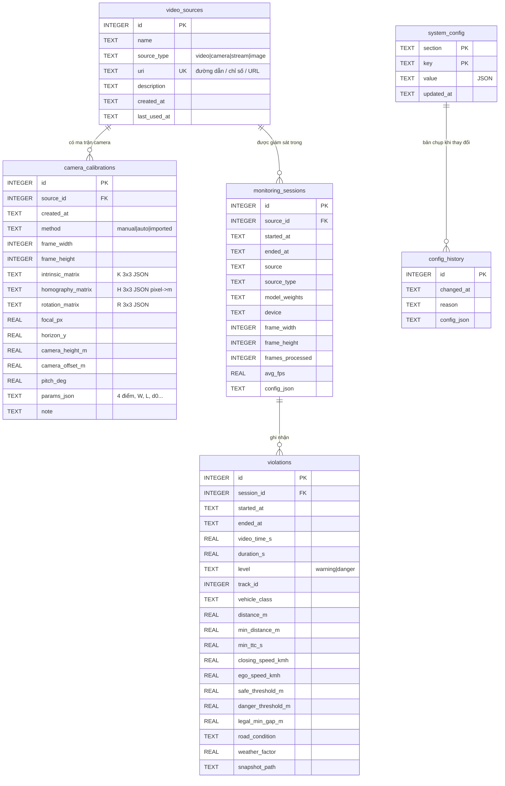

# Thiết kế hệ thống - Cảnh báo khoảng cách an toàn trên cao tốc (YOLOv11 + IPM)

## 1. Kiến trúc phần mềm - luồng xử lý

```
Video Stream ──► YOLOv11 Detection ──► IPM Distance Calculation ──► Alert Engine ──► GUI
```



Điều phối: `gui/worker.py::ProcessingWorker` (luồng nền) đọc khung ① → gọi `adas/pipeline.py::ADASPipeline.process`
(② → ③ → ④) → vẽ ⑤ → gửi `QImage` sang luồng giao diện qua tín hiệu Qt.

| Tầng | Đầu vào → đầu ra | Thuật toán | Thời gian đo được* |
|---|---|---|---|
| ① Video Stream | nguồn → khung BGR + thời điểm t | OpenCV; bám thời gian thực (bỏ khung khi chậm); camera: luồng đọc riêng luôn lấy khung mới nhất | 0,5 ms |
| ② YOLOv11 Detection | khung → danh sách xe (bbox, lớp, ID) | YOLOv11n fine-tune (mAP50 0,84) + ByteTrack | 18,6 ms |
| ③ IPM Distance | khung + danh sách xe → làn xe chủ, tốc độ xe chủ, khoảng cách (m), cùng làn?, TTC | Homography mặt phẳng đường; nhận diện vạch làn trên BEV (top-hat + cửa sổ trượt + đa thức bậc 2); tốc độ từ độ dịch vạch đứt giữa các khung (tương quan chuẩn hóa); EMA; hồi quy tuyến tính d(t) | ≈ 7 ms |
| ④ Alert Engine | khoảng cách → mức cảnh báo, âm thanh, nhật ký | Bảng quy định × hệ số điều kiện; TTC; hysteresis N khung | 0,02 ms |
| ⑤ GUI | kết quả → ảnh hiển thị | QPainter (tiếng Việt), BEV warpPerspective | 8,7 ms |
| **Tổng** | | | **≈ 35 ms/khung ≈ 29 FPS** |

\* Đo trên 600 khung video 640×360, GPU (CUDA). Khi chạy, thanh trạng thái (đáy cửa sổ) hiển thị trực tiếp
`Luồng xử lý (ms): Video Stream → YOLOv11 → IPM → Alert Engine → GUI`.

### Các luồng (thread)



Cấu hình (`AppConfig`) dùng chung theo tham chiếu giữa luồng giao diện và luồng xử lý; mọi thay đổi đi qua
`update_inplace()` nên luồng xử lý thấy giá trị mới ở khung kế tiếp mà không cần khởi động lại.

## 2. Cơ sở dữ liệu

**Hệ quản trị:** SQLite (file `data/adas.db`, có sẵn trong Python, không cần máy chủ - phù hợp phần mềm
chạy trên máy tính trong xe). Giá trị cấu hình và các ma trận 3×3 lưu dạng **JSON** trong cột TEXT.
Chế độ WAL cho phép luồng giao diện đọc trong khi luồng xử lý ghi.

**Khởi tạo:**
```bash
python tools/init_db.py            # tạo lược đồ (nếu chưa có), nâng cấp phiên bản cũ, nạp cấu hình
python tools/init_db.py --reset    # sao lưu CSDL cũ rồi tạo mới
```
Ứng dụng cũng tự khởi tạo khi chạy lần đầu (`adas/storage/database.py::Database.init_schema`), tự nhập
`config/settings.json` cũ và tự nâng cấp lược đồ (phiên bản hiện tại: 3, lưu trong `PRAGMA user_version`).



| Nhóm dữ liệu yêu cầu | Bảng |
|---|---|
| **Thông số cấu hình** | `system_config` (hiện hành) + `config_history` (lịch sử, khôi phục được) |
| **Ma trận camera** | `camera_calibrations`: K (nội tham số), H (ma trận IPM), R (tư thế), f, chiều cao, góc chúc, chân trời - theo từng nguồn trong `video_sources`; dòng mới nhất là ma trận đang dùng |
| **Nhật ký cảnh báo** | `violations` (mỗi đợt vi phạm 1 dòng, kèm ảnh) thuộc `monitoring_sessions`; view `v_session_summary` thống kê theo phiên |

Ràng buộc toàn vẹn: khóa ngoại bật (`PRAGMA foreign_keys = ON`); xóa phiên → xóa vi phạm (CASCADE);
xóa nguồn → xóa ma trận camera của nguồn (CASCADE), phiên cũ giữ lại (`source_id` → NULL);
`CHECK` trên `level`, `source_type`, `method`; `uri` duy nhất (đường dẫn file được chuẩn hóa).

### Ma trận camera được tính thế nào
Từ 4 điểm hiệu chỉnh → homography **H** (ảnh → mặt đường, mét). Phân rã ngược
`H⁻¹ ∝ K·[r₁ r₂ t]` (Zhang, 2000) với tâm ảnh ở giữa khung: ràng buộc ‖r₁‖ = ‖r₂‖ cho tiêu cự f
→ **K** = [[f, 0, cx], [0, f, cy], [0, 0, 1]]; tiếp theo **R** = [r₁ r₂ r₁×r₂], vị trí camera C = −Rᵀt
→ chiều cao camera, khoảng cách camera tới đầu xe, góc chúc. Kiểm chứng trên camera giả lập:
tìm lại đúng f, chiều cao, vị trí và góc chúc (`tools/smoke_test.py::test_camera_matrix`).
